# Dominions 6 AI Mod Generator

A Django app that helps you build a custom nation mod for the strategy game *Dominions 6*. You give it a short idea for a nation, and it walks through a series of steps with Google Gemini to expand the idea into a design document and then write the `.dm` mod code for the nation, its commanders, troops, heroes, spells and items, finishing with a syntax check.

## Why I built it

Writing Dominions mods by hand means learning a big list of `#commands` and looking up weapon and armour IDs. I wanted to see if an LLM could do most of that if it was given the right reference data at each step. I built it as my full-stack Django project for my Level 5 course.

## How it works

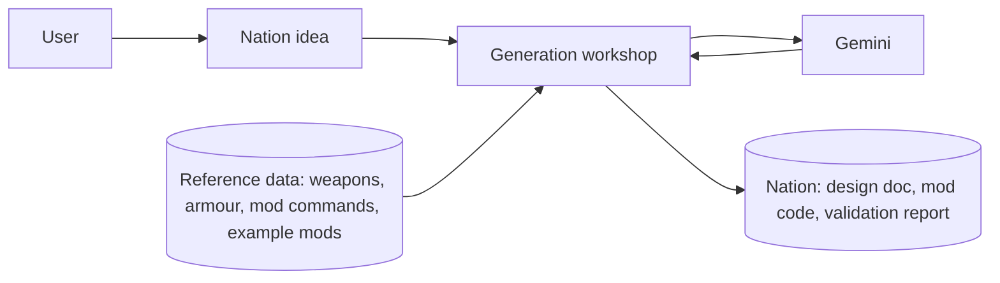

The workshop runs one step at a time, and each step has its own prompt:

1. Expand the idea into a design document
2. Nation details and tags
3. Commanders
4. Troops
5. National heroes
6. National spells
7. Weapons and armour
8. Validation, where Gemini checks the finished mod for syntax mistakes

Each step pulls in only the reference data it needs (a sample of real weapon and armour IDs, mod commands and an example mod) from the `gamedata` tables, and the generated code is added to the nation as it goes.

Anyone can browse nations. You need an account to create one, and only the person who created a nation (or a staff user) can edit it, delete it or run the generation steps.

## Database

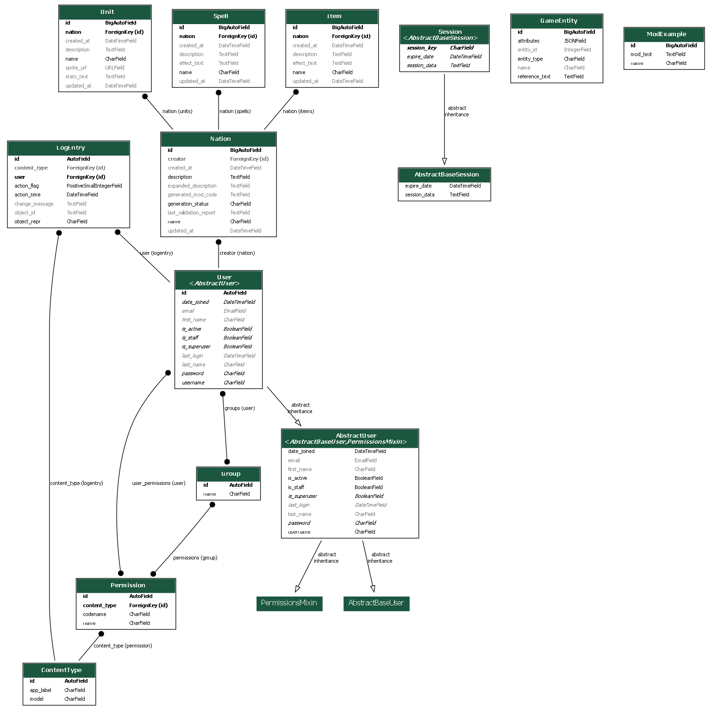

- `Nation` is the main model. It belongs to a user and holds the idea, the expanded design document, the generated mod code and the current step.
- `GameEntity` holds the reference data loaded from `dom6data.jsonl` (weapons, armour, units, mod command names and so on).
- `ModExample` holds example `.dm` files used to show Gemini the right format.
- `Unit`, `Spell` and `Item` models exist and link to a nation, but there are no pages for them yet.

## Running it locally

You need Python 3.12+ and a Gemini API key.

```
python -m venv .venv
source .venv/bin/activate        # .venv\Scripts\activate on Windows
pip install -r requirements.txt
cd dom6modgen
```

Create a `.env` file in `dom6modgen/` with at least:

```
SECRET_KEY=something-long-and-random
DJANGO_DEBUG=True
CSRF_COOKIE_SECURE=False
SESSION_COOKIE_SECURE=False
GEMINI_API_KEY=your-key
```

With no database settings it uses SQLite. Set `DATABASE_URL` (or `DB_NAME`, `DB_USER`, `DB_PASSWORD`) to use Postgres instead.

```
python manage.py migrate
python manage.py load_jsonl_data dom6data.jsonl
python manage.py load_comprehensive_example
python manage.py createsuperuser
python manage.py runserver
```

`load_mod_example gamedata/mod_examples` will also load the community mods in that folder as extra examples. The `Procfile` and `runtime.txt` are there for Heroku.

## Tests

```
cd dom6modgen
python manage.py test
```

There are 18 tests covering the nation model, the CRUD views, login and ownership rules, and running a generation step with Gemini mocked out.

I also tested the pages by hand while building it:

| What I tested | Screenshot | Result |
| :-- | :-- | :-- |
| Nation list | 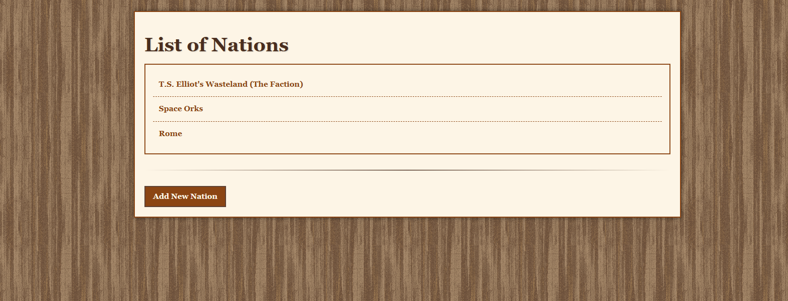 | Pass |
| Nation detail | 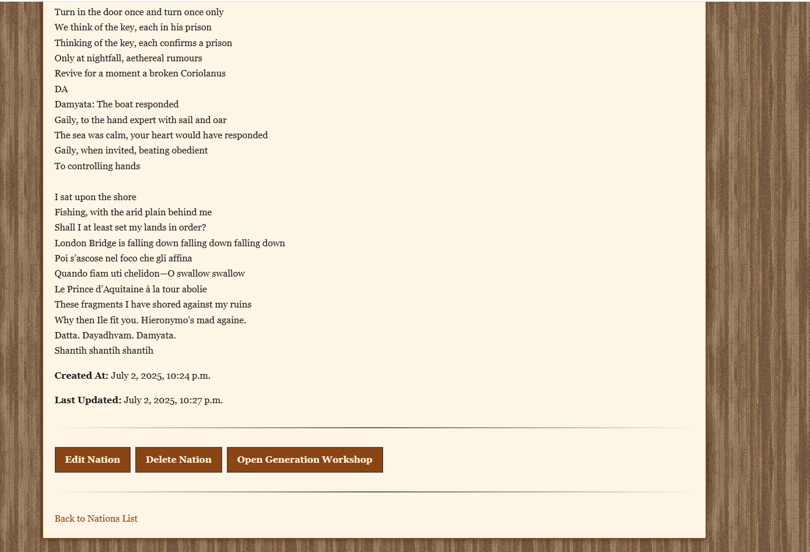 | Pass |
| Create nation | 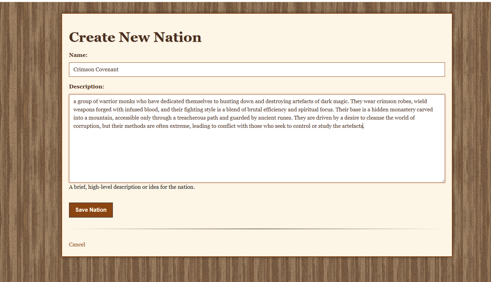 | Pass |
| Invalid form input | 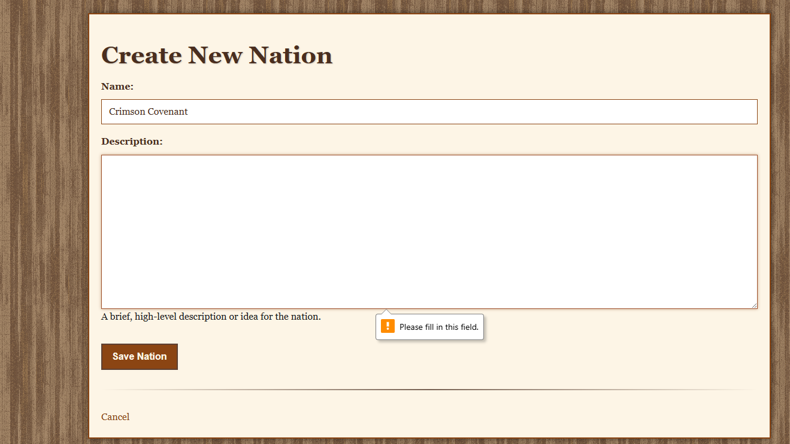 | Pass |
| Edit nation | 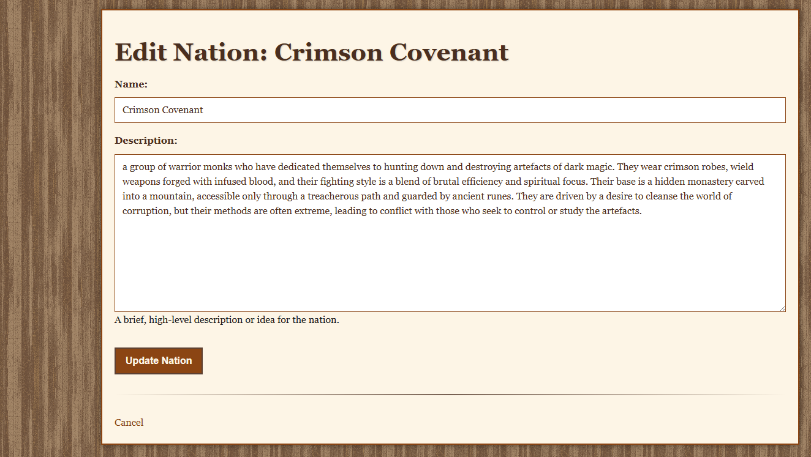 | Pass |
| Delete nation | 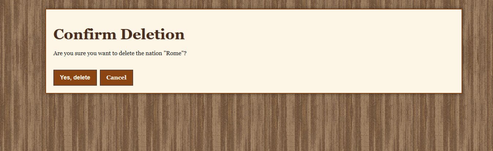 | Pass |
| Workshop step and loading spinner | 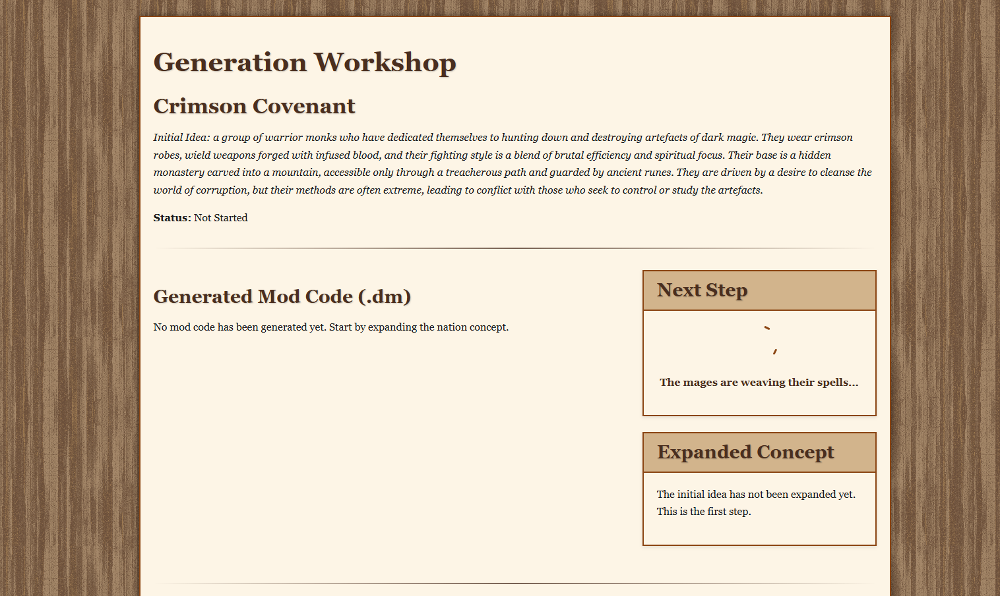 | Pass |
| Mobile view | 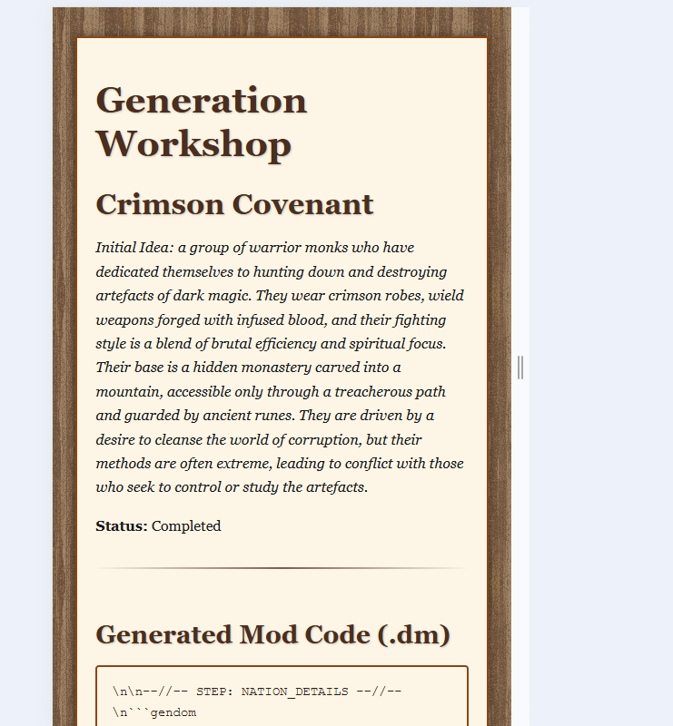 | Pass |
| Opera | 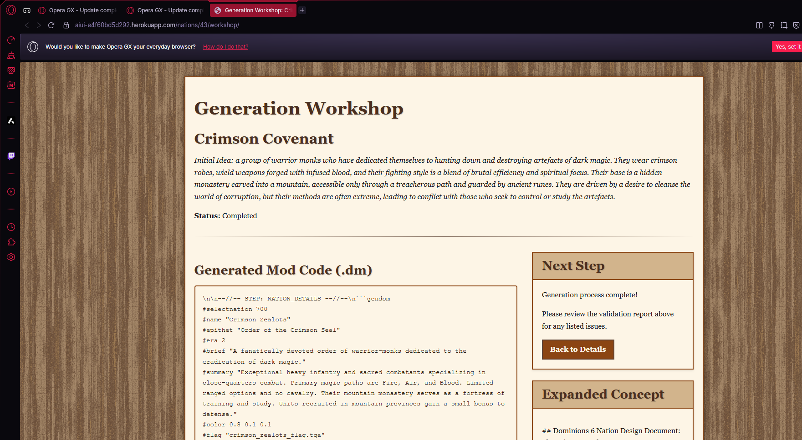 | Pass |
| W3C HTML validator | 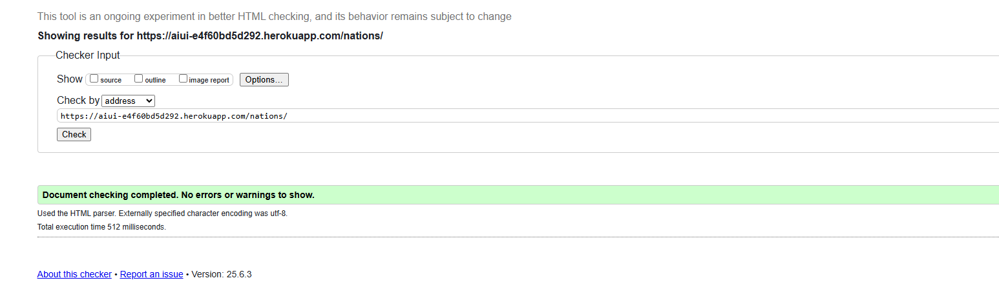 | Pass |
| W3C CSS validator | 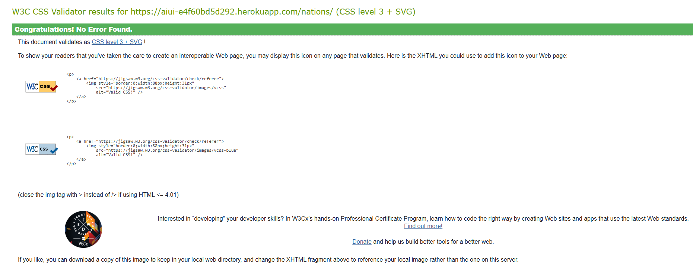 | Pass |

## Known limitations and next steps

- The generated mods still need checking in game. The validation step is Gemini reading its own output, not a real parser, so it misses things.
- Each step is a single blocking request, so the page just waits on Gemini. It should really run in a background task.
- The model name is hardcoded in `nations/views.py` and it uses the `google-generativeai` package, which Google has deprecated. Both need updating.
- If a step fails the nation is marked as failed and there's no retry button yet.
- I'd like to add pages for units, spells and items so you can tweak them before exporting, and a button to download the finished `.dm` file.
